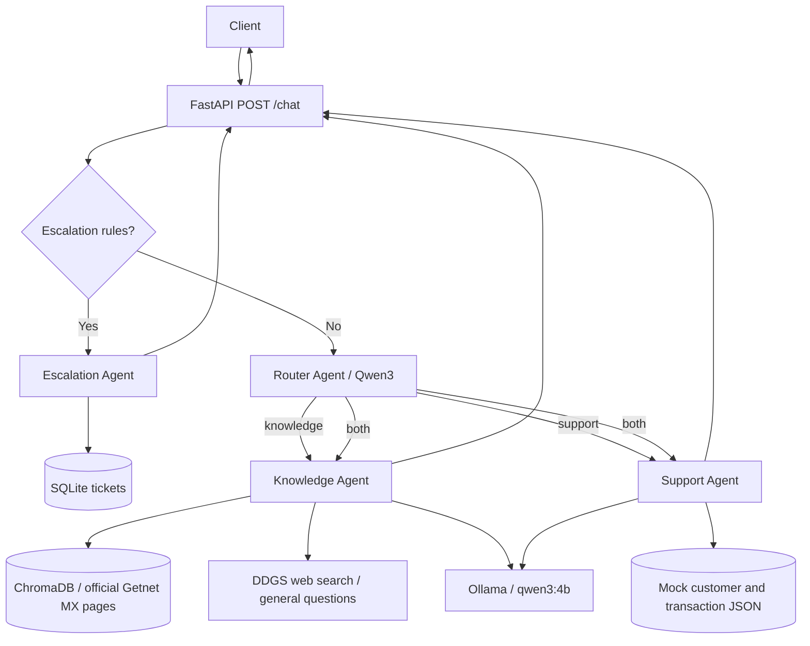

# Getnet Multi-Agent Support System

A local-first, multi-agent customer support API built with **Python 3.12**, **FastAPI**, **Ollama**, and **Retrieval-Augmented Generation (RAG)**. The project follows a **Spec-Driven Development (SDD)** approach; see [SPEC.md](SPEC.md).

## Features

- **Router Agent:** uses `qwen3:4b` to classify requests as `knowledge`, `support`, or `both`.
- **Knowledge Agent:** retrieves official Getnet Mexico content from a local ChromaDB vector store, or performs external searches with DDGS for general questions.
- **Support Agent:** uses `get_customer` and `get_transactions` to read mock JSON records scoped to the supplied `user_id`.
- **Escalation Agent:** detects selected escalation requests and creates **simulated** tickets in SQLite.
- **FastAPI:** exposes `POST /chat`, `GET /health`, and interactive API docs.
- **Automated tests:** 21 pytest tests passed in the development environment.

## Architecture



The escalation rules run **before** LLM-based routing. Combined requests execute both specialized agents and return their results together.

## Tech stack

| Component | Technology |
| --- | --- |
| API and validation | FastAPI, Pydantic |
| Language | Python 3.12 |
| Local LLM | Ollama, `qwen3:4b` |
| Embeddings | Ollama, `nomic-embed-text` |
| Vector database | ChromaDB (persistent) |
| External search | DDGS |
| Mock customer data | JSON |
| Simulated escalation tickets | SQLite |
| Tests | pytest |
| Container | Docker |

## Repository structure

```text
app/
  agents/
    escalation.py
    knowledge.py
    router.py
    support.py
  tools/
    customer.py
    tickets.py
    web_search.py
  llm.py
  main.py
  rag.py
  schemas.py
data/
  customers.json
  transactions.json
  tickets.db             # Local runtime file; do not commit
scripts/
  ingest.py
tests/
  test_chat.py
  test_customer_tools.py
  test_knowledge.py
chroma_db/                # Generated vector index; see RAG setup
Dockerfile
.dockerignore
.gitignore
requirements.txt
SPEC.md
README.md
```

## Prerequisites

- Python 3.12 and `pip`
- Ollama installed and running locally
- Docker (optional, for containerized API)
- Network access for initial Getnet document ingestion and external web search

## Local setup

### 1. Clone and install

```bash
git clone <YOUR_REPOSITORY_URL>
cd getnet-multiagent-support-system
python3.12 -m venv .venv
source .venv/bin/activate
pip install -r requirements.txt
```

On Windows, activate the virtual environment using the appropriate shell command instead.

### 2. Start Ollama and download models

In a separate terminal, ensure Ollama is running:

```bash
ollama serve
```

If Ollama is already running as a service, do not start a second instance. Download both models:

```bash
ollama pull qwen3:4b
ollama pull nomic-embed-text
ollama list
```

By default, the application connects to `http://127.0.0.1:11434`. Override this using the `OLLAMA_URL` environment variable if needed.

### 3. Build the local RAG index

The Knowledge Agent uses a persistent ChromaDB index. If `chroma_db/` is not included in your clone, create it before starting the API:

```bash
python scripts/ingest.py
```

The initial ingestion covers selected public pages from the official **Getnet Mexico** site, including the payment terminal with printer and Getnet Portal. The index is not a complete representation of Getnet policies or products.

### 4. Start the API

```bash
uvicorn app.main:app --host 127.0.0.1 --port 8000
```

- Health endpoint: <http://127.0.0.1:8000/health>
- Swagger UI: <http://127.0.0.1:8000/docs>
- OpenAPI specification: <http://127.0.0.1:8000/openapi.json>

## Docker setup (Linux host with local Ollama)

**Important:** The current Dockerfile copies `chroma_db/` into the image. Run `python scripts/ingest.py` on the host **before building**, unless the vector index already exists.

```bash
docker build -t getnet-multiagent .
```

The tested development configuration uses Linux host networking because the local Ollama instance listens on `127.0.0.1:11434`:

```bash
docker run --rm \
  --name getnet-api \
  --network host \
  -e OLLAMA_URL=http://127.0.0.1:11434 \
  -e TICKETS_DB_PATH=/app/ticket_storage/tickets.db \
  -v getnet_tickets:/app/ticket_storage \
  getnet-multiagent
```

Open <http://127.0.0.1:8000/docs> to test the containerized API. The named Docker volume persists simulated tickets between container runs.

**Portability note:** `--network host` is the documented **Linux development** setup, not a universal cross-platform deployment recipe. On macOS or Windows, adapt Docker networking and `OLLAMA_URL` to make the host Ollama service reachable from the container. Ensure port `8000` is not already occupied by a locally running Uvicorn process.

## API usage

### Health check

```bash
curl http://127.0.0.1:8000/health
```

Expected response:

```json
{"status":"ok"}
```

### Chat request

```bash
curl -X POST http://127.0.0.1:8000/chat \
  -H 'Content-Type: application/json' \
  -d '{"message":"What is Getnet Portal?","user_id":"cliente001"}'
```

The response follows this structure (answer and sources vary with retrieval and model output):

```json
{
  "answer": "<grounded response generated by the agent>",
  "agents_used": ["router", "knowledge"],
  "sources": ["<retrieved source URL>"],
  "status": "success"
}
```

Try these additional requests in Swagger:

| Scenario | `message` | `user_id` |
| --- | --- | --- |
| Customer support | `What is the status of transaction TX001?` | `cliente001` |
| Combined | `What is the status of TX001 and what is Getnet Portal?` | `cliente001` |
| General web search | `What is GETNET?` | `cliente001` |
| Escalation | `I want to speak with a human agent.` | `cliente001` |

The response field `status` can be `success`, `insufficient_information`, `pending_human_review`, or `error`. Escalation creates a **local simulated ticket**; it does not contact a human operator.

## Automated tests

From the project root with the virtual environment activated:

```bash
python -m pytest tests/ -v
```

**Development validation:** 21 tests passed. The suite covers API routing, request validation, mock-customer lookup, knowledge classification, escalation, and selected provider-failure scenarios. Some tests use mocks; passing the suite does not replace end-to-end validation with live Ollama, DDGS, and Docker.

## Configuration

| Environment variable | Purpose | Development default |
| --- | --- | --- |
| `OLLAMA_URL` | Ollama API base URL | `http://127.0.0.1:11434` |
| `TICKETS_DB_PATH` | SQLite path for simulated escalation tickets | `data/tickets.db` |

Do not commit secrets or real customer data. `user_id` in this MVP is an unverified lookup key, **not** an authentication or authorization mechanism.

## Source policy and limitations

- Getnet-specific answers are intended to use ingested **official Getnet Mexico** documentation. General-topic questions may use DDGS external search results.
- The knowledge index covers only a small subset of official pages; missing or irrelevant evidence can lead to `insufficient_information`.
- External web search can be unavailable, rate-limited, or return no results.
- LLM-generated answers and cited sources should be reviewed for factual accuracy; retrieval alone does not guarantee correctness.
- The customer and transaction records are **mock data**. No production Getnet customer systems are connected.
- `user_id` is supplied by the caller without verification.
- Escalation tickets are simulated and stored locally; no human support team is notified.
- Docker execution has been tested using Linux host networking with a locally running Ollama service.

## Spec-Driven Development

The project's scope, functional requirements, API contract, acceptance criteria, and known limitations are documented in [SPEC.md](SPEC.md). Implementation and validation are organized around that specification.

## Suggested improvements

Authentication and authorization, expanded official-source coverage, retrieval relevance thresholds, stronger citation verification, observability, end-to-end integration tests, and a real escalation integration would be required before production use.
